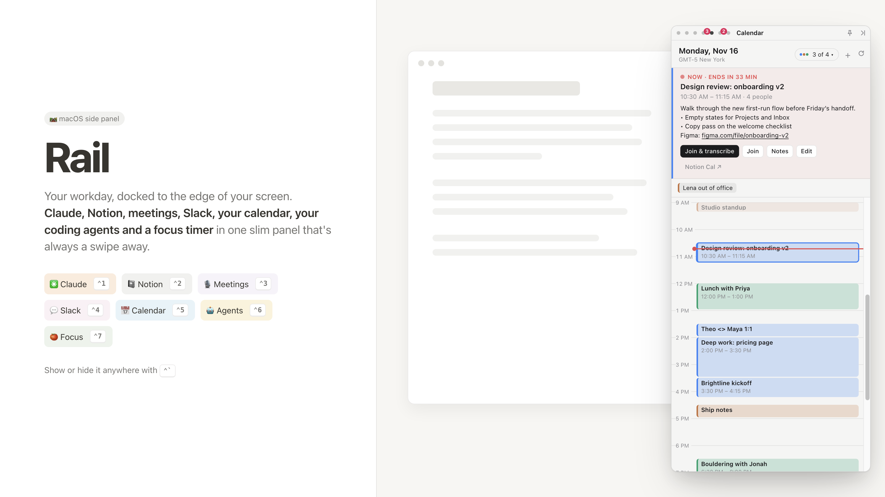
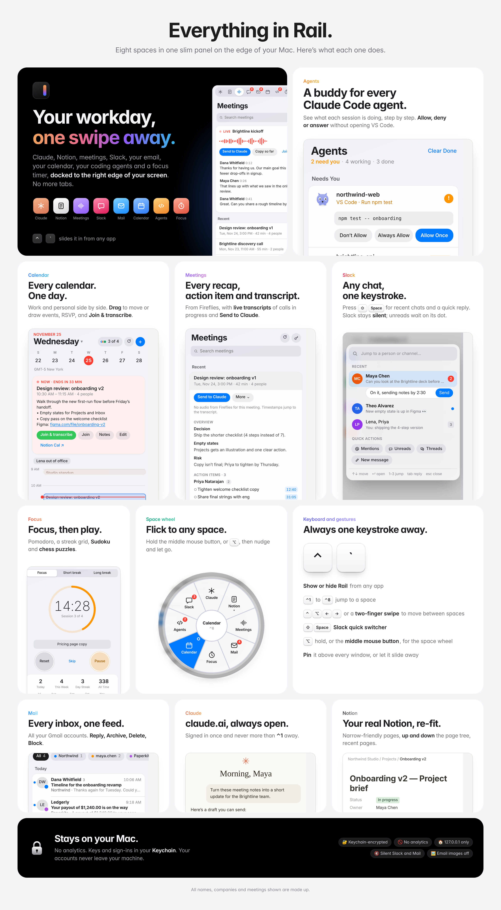
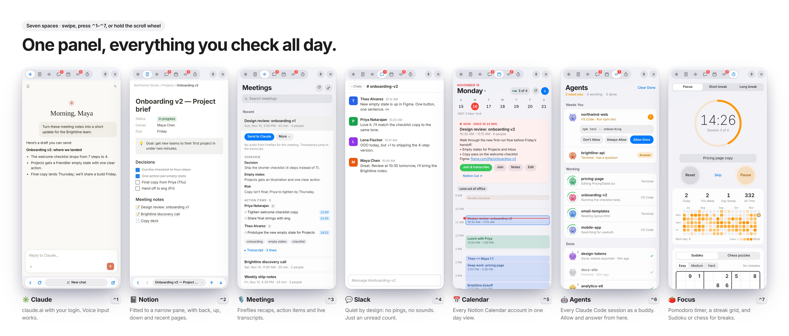
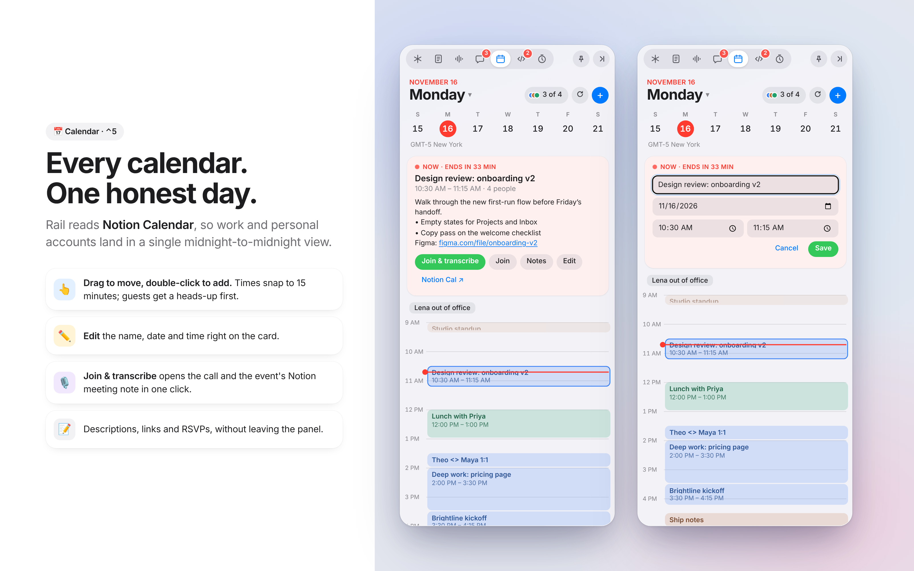
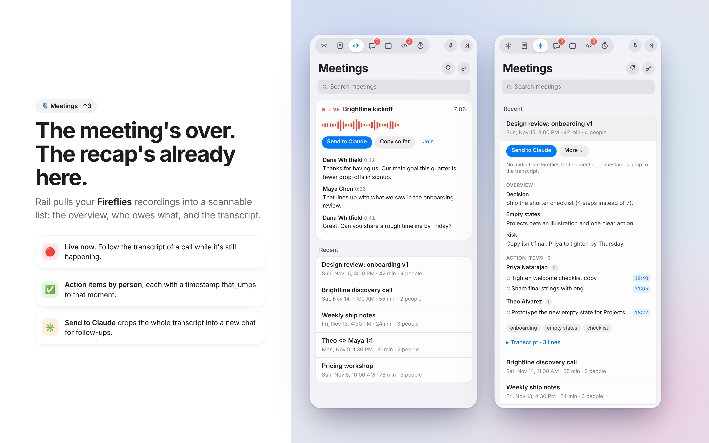
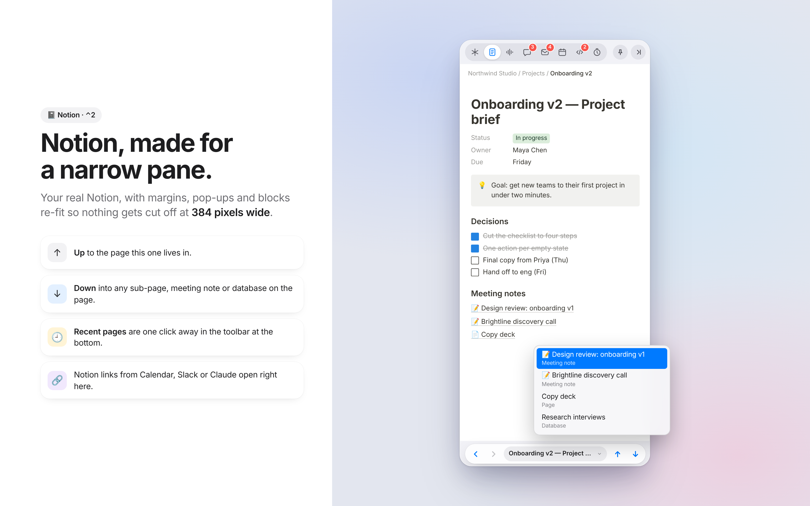
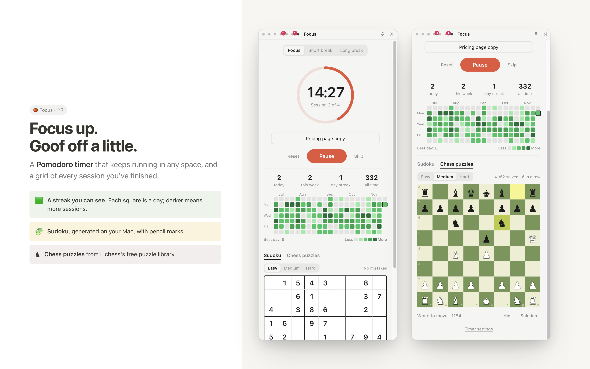
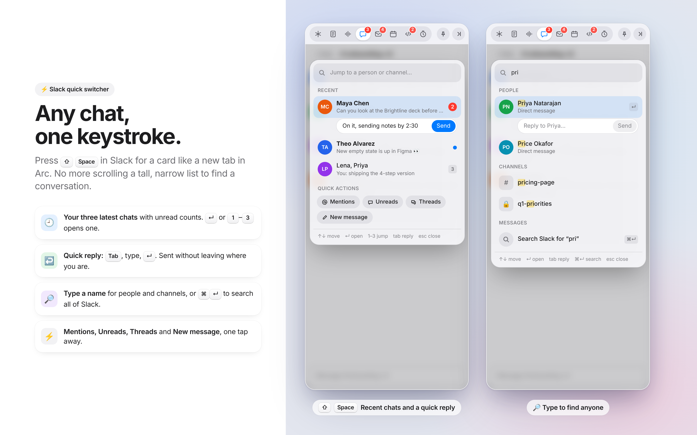
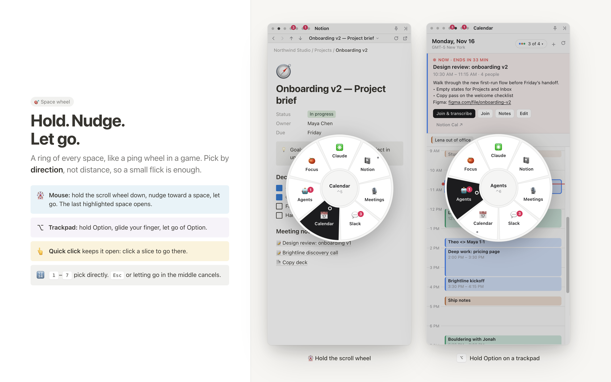

# Rail

**Rail is a side panel that lives on the right edge of your Mac.** It keeps the tools you check all day (Claude, Notion, your meeting recaps, Slack, today's calendar and a focus timer) one keystroke away, without another browser tab or another app window.

It looks and feels like part of macOS: a frosted-glass panel floating just inside the edge of the screen, a tab bar of space symbols across the top, big titles, rounded lists and the system colors, in light and dark mode.

Press `⌃` `` ` `` anywhere to slide it in or out. Swipe with two fingers on the panel, or press `⌃1` to `⌃8`, to move between spaces.

> All names, companies and meetings in these images are made up.

---

## Everything at a glance



---

## Eight spaces, one panel



| | Space | Key | What it's for |
| --- | --- | --- | --- |
| ✳️ | **Claude** | `⌃1` | claude.ai, signed in, always open. |
| 📓 | **Notion** | `⌃2` | Your real Notion, re-fit for a narrow pane. |
| 🎙️ | **Meetings** | `⌃3` | Fireflies recaps, action items, transcripts and live calls. |
| 💬 | **Slack** | `⌃4` | Slack, completely silent. Unreads show as a count on its tab. |
| ✉️ | **Mail** | `⌃5` | Every Gmail account in one feed. Reply, Archive, Delete, Block. |
| 📅 | **Calendar** | `⌃6` | Today from every Notion Calendar account, in one view. |
| 🤖 | **Agents** | `⌃7` | Every Claude Code session as a little buddy: what it's doing, Allow, answers. |
| 🍅 | **Focus** | `⌃8` | A Pomodoro timer, a streak grid, Sudoku and chess puzzles. |

---

## 📅 Calendar



- **Every account in one day.** Work and personal calendars from Notion Calendar show side by side, a color per calendar. The `3 of 4 ▾` menu picks which ones show.
- **Any day.** Click the date for a month view and pick a day; **Today** brings you back.
- **Move things fast.** Drag an event to move it (it snaps to 15 minutes). **Drag across empty time** to draw a new event, or double-click a slot, or press **+**.
- **Edit** an event's name, date and time on its card. If other people are invited, Rail asks first, because they'll get an update.
- **Click an event** to read its description and location, RSVP, open its Notion meeting note, or **Join & transcribe** the call.
- **A nudge** 5 minutes before each meeting. The Calendar tab counts down (`12m`, `now`).

## ✉️ Mail

- **Every inbox in one feed.** Sign in to as many Gmail and Google Workspace accounts as you like. Their inboxes merge into one list, newest first, grouped by day. A colored dot on each sender's picture shows which account it came to.
- **Focus on one account.** The chips under the title (`All · Work · Personal…`) filter to one inbox, with its unread count. `1` is All, `2`–`9` are your accounts.
- **Four actions on every email:** **Reply**, **Archive**, **Delete** and **Block**. Hover an email in the list for quick buttons, or open it for the button bar at the bottom.
  - **Reply** sends from the account the email came to. Tap **Thanks!**, **Sounds good 👍** or **I'll get back to you tomorrow** to fill it in, then `⌘↵` to send.
  - **Delete** moves the conversation to Gmail's Trash. **Archive** takes it out of the inbox. Both show **Undo** for a few seconds.
  - **Block** adds a Gmail filter that sends the sender's future mail straight to Trash, so it holds on your phone too. It can also move their earlier emails to Trash and unsubscribe you from mailing lists. Unblock anyone under **Accounts**.
- **Search** (the magnifying glass, or `/`) searches all your mail in every account, with Gmail's own search.
- **Private by default.** Emails show without remote images until you click **Show**, so senders can't tell you opened them. HTML emails run in a sandbox with no scripts.
- **Silent.** No notifications. Unread conversations show as a count on the Mail tab. Rail checks for new mail every minute.
- **Keyboard:** `J` / `K` move, `↵` opens, `Esc` goes back, `R` reply, `E` archive, `D` delete, `B` block, `C` new email, `/` search.

**Set up:** see [Mail](#mail-gmail) under Set up.

## 🎙️ Meetings



- Your **Fireflies** recordings, newest first, with search.
- Open one for the **overview, action items grouped by person, keywords and the full transcript**. Timestamps jump to that moment in the recording.
- **Live now:** while Fireflies is in a call, follow the transcript as it happens.
- **Send to Claude** drops the whole transcript into a new Claude chat, so you can ask for a follow-up email or a summary.

## 🤖 Agents

When Claude Code is minimized, you can't see what your agents are doing. The Agents space shows you.

- **A buddy per session.** Every Claude Code session on your Mac (VS Code, Cursor, Terminal, iTerm…) gets its own little creature. It bobs while it works, hops with a **!** or **?** when it needs you, and dozes when it's done. Sessions are listed under **Needs You**, **Working** (with a progress ring) and **Done**, and the Agents tab counts the ones waiting on you.
- **Click one** to follow it step by step: your prompt, each file it reads or edits, each command, and its reply.
- **Allow Once / Don’t Allow** a permission prompt right in the list (or **Always Allow**). Claude Code's own prompt still shows too; whichever you answer first wins.
- **Answer its questions** without opening the editor: pick an option or type your own.
- **Open in VS Code** (or whichever app it runs in) jumps back to its window. **✕** crosses a session off; **Clear done** clears every finished one.
- A notification when an agent needs you while Rail is hidden or on another space.

**Set up:** open the Agents space and click **Connect Claude Code**. Rail adds a hook to `~/.claude/settings.json` (and keeps a backup next to it). At each step, Claude Code posts what it's doing to Rail on `127.0.0.1` only. If Rail isn't running, Claude Code works exactly as before. Sessions that were already open pick it up after a restart. **Disconnect Claude Code**, at the bottom of the space, removes the hook.

## 📓 Notion



- The real Notion site, with margins, pop-ups and blocks re-fit so nothing gets cut off at 384 px wide.
- A toolbar at the bottom, like Safari's: **back / forward**, **↑ up** to the page this one lives in, and **↓ down** into any sub-page, meeting note or database on the page.
- Click the page title in the toolbar for your **15 most recent pages**, Notion home, reload, or "open in the Notion app".
- `notion://` links from Calendar, Slack or Claude open right here instead of in a browser.

## 🍅 Focus



- A **Pomodoro timer** (25 / 5 / 15 by default, a long break every 4). It keeps running while you're in other spaces and lets you know when a session ends.
- A **streak grid** of every finished session over the last 21 weeks, plus today, this week and all-time counts.
- For the breaks: **Sudoku** (generated on your Mac, with pencil marks) and **chess puzzles** from Lichess's free puzzle library.

## 💬 Slack and ✳️ Claude

Both are the real sites, signed in once and kept open. Claude has its own toolbar at the bottom: back, reload, **New chat** and open in the browser. Slack in Rail is **silent**: no notifications and no alert sounds (huddles and clips you click still play). The unread count shows only on Slack's tab. Hovering a message shows only Slack's ⋮ menu, not the row of reactions and buttons; press **R** to react or **T** to reply while hovering.

### ⚡ Slack quick switcher



Press **Shift+Space** in Slack (anywhere except a message you've started typing) for a card over the chat, like a new tab in Arc:

- **Your three most recent DMs and group DMs**, with **unread counts**. `Enter` or `1`–`3` opens one, with no scrolling.
- **A reply line** for the selected chat: press `Tab`, type, press `Enter` to send without leaving where you are.
- **Type a name** to find people (including people from other companies you DM) and channels. `⌘↵` runs Slack's full search instead.
- **Mentions, Unreads, Threads and New message** buttons.
- `↑` `↓` move, `Esc` closes.

### Huddles, calls and screen sharing

- In a huddle, Slack's call window docks as a card **across the bottom** of the pane, and the chat moves up above it instead of being covered. **Open in a new window** pops the call out into its own window.
- **Screen sharing and clips:** pick a whole screen or one window from Rail's menu. macOS asks once for Screen Recording permission (System Settings → Privacy & Security → Screen & System Audio Recording); quit and reopen Rail after allowing it. Because Rail isn't signed with a developer certificate, **each rebuild needs that permission again**: remove Rail from that list with **–**, reopen Rail and allow it again.

---

## Install

You need an **Apple Silicon Mac**, [Node.js](https://nodejs.org) 20 or later, and Git.

```bash
git clone https://github.com/habibedits/rail.git
cd rail
npm install
npm run install-app
```

That builds `Rail.app`, copies it into `/Applications` and opens it. It opens at login by default; untick **Rail menu → Open at Login** to stop that.

Rail isn't code-signed. If macOS blocks it the first time, right-click Rail in Applications and choose **Open**.

**Updating:** `git pull && npm install && npm run install-app`.

## Set up (first run)

1. **Claude, Notion and Slack:** sign in inside each space. Google blocks its sign-in button inside embedded apps like Rail, so either:
   - use **Rail menu → Import Logins from Arc…**, which copies just your Claude, Notion and Slack logins from Arc (macOS asks once to allow "Arc Safe Storage"; click Allow), or
   - sign in with your email address and the code the site sends you. It's the same account as your Google sign-in.
2. **Calendar:** open the Calendar space and click **Connect**. Approve Rail in Notion in your browser. Rail reads every account you've added to Notion Calendar.
3. **Meetings:** open the Meetings space and paste your Fireflies API key (in Fireflies: **Integrations → Fireflies API**). It's stored encrypted in your Keychain.
4. **Mail:** see below.

### Mail (Gmail)

Google only lets an app read Gmail once the app is registered with Google. Rail has no server, so you register your own copy, once. It's free, any normal Gmail account can do it, and it's never per email: afterwards every account is just **Sign in with Google**.

1. Open [Google Cloud](https://console.cloud.google.com/projectcreate) with any Google account and create a project called **Rail**.
2. Open the [Gmail API](https://console.cloud.google.com/apis/library/gmail.googleapis.com) page for that project and click **Enable**.
3. Open [Google Auth Platform](https://console.cloud.google.com/auth/overview) and click **Get started**. App name **Rail**, your email as support email, **External** audience, your email as contact, agree, **Create**.
4. Go to **Clients → Create client**. Application type **Desktop app**, name **Rail**, **Create**, then **Download JSON**.
5. Go to **Audience → Publish app → Confirm**. (Unpublished apps sign you out every 7 days.)
6. Move the downloaded `client_secret_….json` into your `rail` folder, unrenamed, and run `npm run install-app`. The build prints **✓ Mail: built in the Google sign-in**.
7. Open the Mail space and click **Sign in with Google**. Google says the app isn't verified: click **Advanced → Go to Rail (unsafe)**, tick both Gmail boxes, **Continue**. Add more accounts from the person button → **+ Add a Gmail account**.

The file is gitignored, so it stays on your Mac. To let a friend use your registration, send them the file privately (up to 100 people can sign in to an unverified app). Without the file, the Mail space asks for the client ID and secret instead.

Rail asks for two permissions: **read, send and organize mail** (`gmail.modify`: no permanent deletes, Delete goes to Trash) and **manage filters** (`gmail.settings.basic`: only for Block). The client and each account's sign-in are stored encrypted in your Keychain. Mail goes only between your Mac and Google.

## 🎯 Space wheel



Jump to any space without hunting for its tab, like a ping wheel in a game.

- **Mouse:** hold the **middle button** (click the scroll wheel) anywhere on Rail. A pie of every space pops up. Nudge toward a slice and **let go**: the last highlighted space opens. It goes by direction, not distance, so a small flick is enough. **Slack, Claude and Notion are the top three slices**, so the spaces you open most are a flick up.
- **Trackpad:** hold **Option (⌥)** for a moment, glide your finger toward a space, and **let go of Option**.
- **Quick click instead of hold:** a quick middle click (or a short Option hold) leaves the wheel open. Click a slice to go there.
- While it's open, `1`–`8` pick directly, and `Esc`, or letting go in the middle, cancels.
- Don't want Option to open it? Untick **Rail menu → Hold Option for Space Wheel**.

## Keyboard and gestures

| Do this | To |
| --- | --- |
| `⌃` `` ` `` | Show or hide Rail, from any app |
| `⌃1` … `⌃8` | Jump to a space (while Rail has focus) |
| `⌃⌥←` / `⌃⌥→`, or a two-finger swipe on the panel | Previous / next space |
| Hold the middle mouse button, or hold `⌥` | Space wheel: nudge toward a space and let go |
| `⇧Space` (in Slack) | Slack quick switcher: recent chats, quick reply, search |
| Pin button (top right) | Keep Rail above other windows |
| Hide button (top right) | Slide Rail away |

## Your data stays on your Mac

- **Nothing personal is in this repo.** Your logins, the Fireflies key, Notion Calendar access and Focus history live only on the Mac you set up.
- Logins live in Rail's own browser storage in `~/Library/Application Support/Rail`. The Fireflies key, Notion Calendar tokens and Gmail sign-ins are encrypted with the macOS Keychain.
- Someone who clones the repo gets the code, not your accounts. They sign in to their own.
- Rail talks only to the services you use (claude.ai, Notion, Slack, Gmail, Fireflies, Lichess) and has no analytics. The Agents space listens only on `127.0.0.1`, and only to Claude Code hooks that carry its private token.

---

## For developers

```bash
npm install
npm run dev
```

`npm run dev` rebuilds the main process, starts Vite for Rail's own UI and launches Electron. UI changes in `src/renderer` hot-reload; changes in `src/main` or `src/preload` need a restart. `npm start` runs a production build without Vite. Quit the installed app first: the dev copy and the installed copy share one login store, so only one can run at a time.

### Layout of the code

- `src/main/main.ts`: the window, docking, spaces, link handling and IPC.
- `src/main/notionCal.ts`: Notion Calendar through Notion's MCP server.
- `src/main/gmail.ts`: the Mail space. Google sign-in, the merged inbox, reply, archive, trash and block through the Gmail API.
- `src/main/agents.ts`: the Agents space. A local server for Claude Code hooks, session state, and installing or removing the hook.
- `src/main/config.ts`: settings that aren't secret (`config.json` in Rail's userData).
- `src/main/secrets.ts`: Keychain-encrypted secrets.
- `src/preload/`: `web.ts` for the sites (swipe, Slack silencing), `slackCompact.ts` and `slackSwitcher.ts` for Slack's narrow layout, huddle card and quick switcher, `shell.ts` for Rail's own UI (the `window.rail` bridge), `swipe.ts` for gesture detection.
- `src/renderer/`: React UI for the top strip, the Notion bar, Meetings, Calendar and Focus.
- `docs/design/`: how the images in this README are made (see below).

### Remaking the README images

The images use Rail's real React screens with made-up data (`docs/design/mock.ts`), framed in Apple-style pages (`docs/design/shots/`).

```bash
npx vite --config docs/design/vite.config.mts
```

In a second terminal:

```bash
TZ=America/New_York DESIGN_WAIT=6000 npx electron docs/design/render.cjs docs/images hero=shots/hero.html@1600x900 spaces=shots/spaces.html@2300x980 calendar=shots/calendar.html@1600x1000 meetings=shots/meetings.html@1600x1000 focus=shots/focus.html@1600x1000 notion=shots/notion.html@1600x1000 wheel=shots/wheel.html@1600x1000 switcher=shots/switcher.html@1600x1000 bento=shots/bento.html@1600x2692
```

Open `http://127.0.0.1:5181/panel.html?space=calendar` (or `meetings`, `agents`, `focus`, `notion`, `slack`, `claude`) to see a single panel.

### Debugging

`RAIL_DEBUG_PORT=9339 npm run dev` opens a Chrome DevTools port (listed at `http://localhost:9339/json`). It exposes your signed-in sessions, so leave it off normally.
