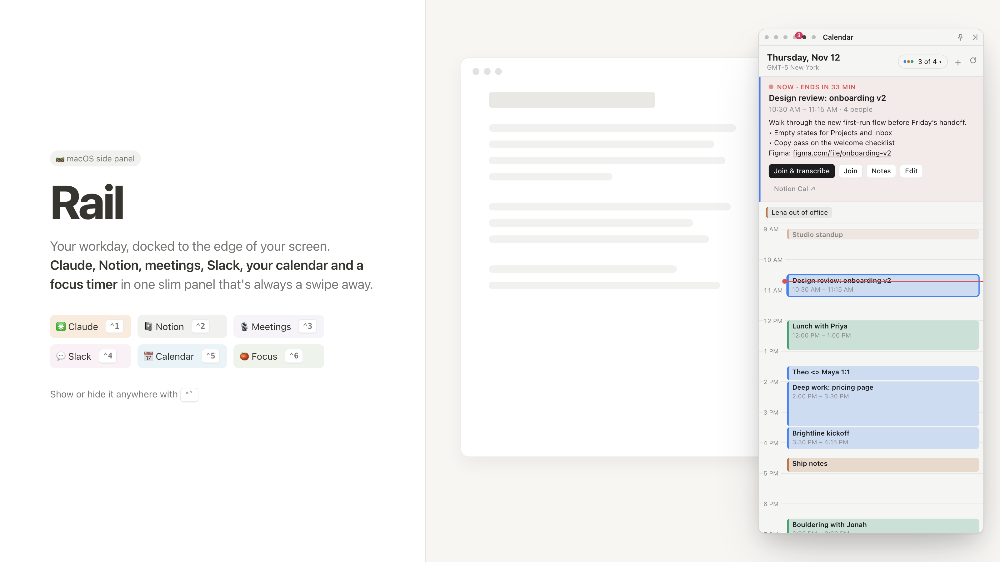
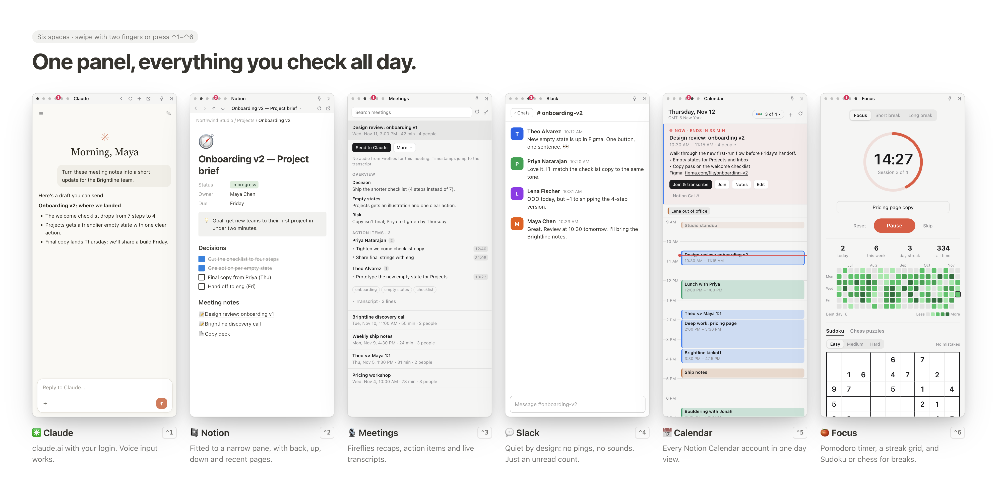
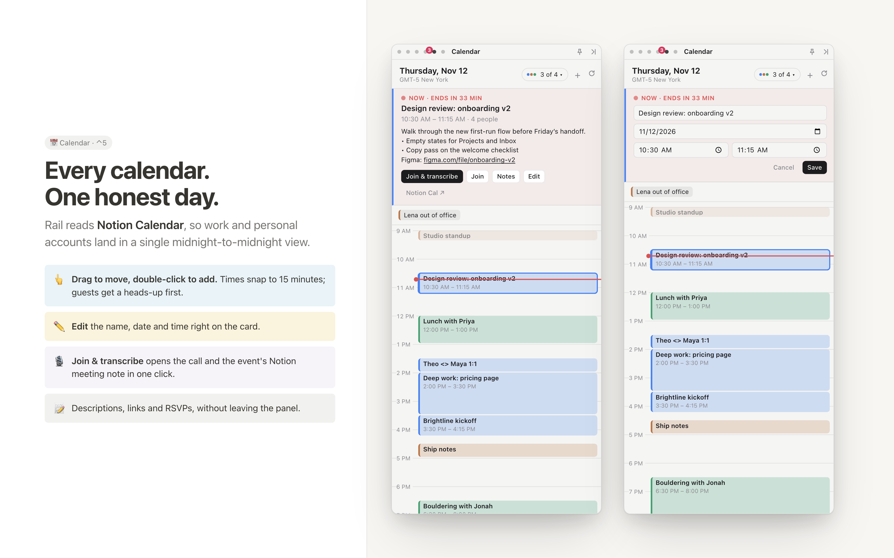
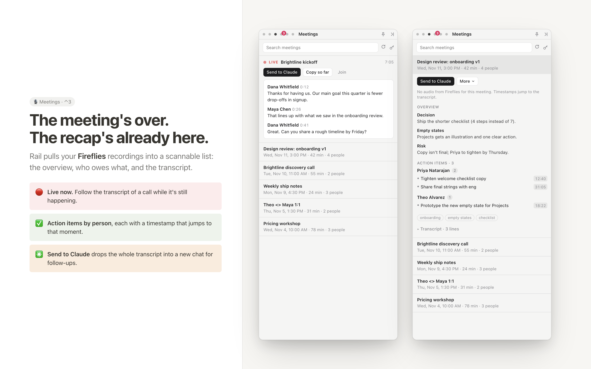
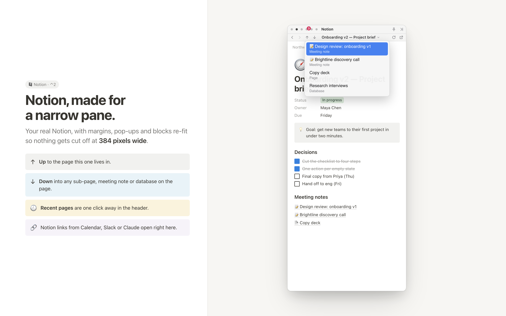
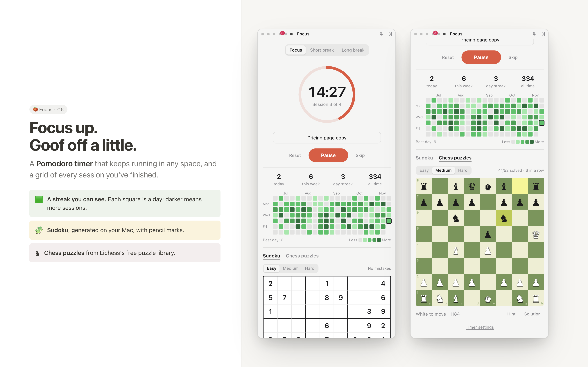

# Rail

**Rail is a side panel that lives on the right edge of your Mac.** It keeps the tools you check all day (Claude, Notion, your meeting recaps, Slack, today's calendar and a focus timer) one keystroke away, without another browser tab or another app window.

Press `⌃` `` ` `` anywhere to slide it in or out. Swipe with two fingers on the panel, or press `⌃1` to `⌃6`, to move between spaces.

> All names, companies and meetings in these images are made up.

---

## Six spaces, one panel



| | Space | Key | What it's for |
| --- | --- | --- | --- |
| ✳️ | **Claude** | `⌃1` | claude.ai, signed in, always open. |
| 📓 | **Notion** | `⌃2` | Your real Notion, re-fit for a narrow pane. |
| 🎙️ | **Meetings** | `⌃3` | Fireflies recaps, action items, transcripts and live calls. |
| 💬 | **Slack** | `⌃4` | Slack, completely silent. Unreads show as a count on its dot. |
| 📅 | **Calendar** | `⌃5` | Today from every Notion Calendar account, in one view. |
| 🍅 | **Focus** | `⌃6` | A Pomodoro timer, a streak grid, Sudoku and chess puzzles. |

---

## 📅 Calendar



- **Every account in one day.** Work and personal calendars from Notion Calendar show side by side, a color per calendar. The `3 of 4 ▾` menu picks which ones show.
- **Move things fast.** Drag an event to move it (it snaps to 15 minutes). Double-click an empty slot, or press **+**, to add one.
- **Edit** an event's name, date and time on its card. If other people are invited, Rail asks first, because they'll get an update.
- **Click an event** to read its description and location, RSVP, open its Notion meeting note, or **Join & transcribe** the call.
- **A nudge** 5 minutes before each meeting. The Calendar dot counts down (`12m`, `now`).

## 🎙️ Meetings



- Your **Fireflies** recordings, newest first, with search.
- Open one for the **overview, action items grouped by person, keywords and the full transcript**. Timestamps jump to that moment in the recording.
- **Live now:** while Fireflies is in a call, follow the transcript as it happens.
- **Send to Claude** drops the whole transcript into a new Claude chat, so you can ask for a follow-up email or a summary.

## 📓 Notion



- The real Notion site, with margins, pop-ups and blocks re-fit so nothing gets cut off at 384 px wide.
- **Back / forward**, **↑ up** to the page this one lives in, and **↓ down** into any sub-page, meeting note or database on the page.
- Click the page title for your **15 most recent pages**, Notion home, or "open in the Notion app".
- `notion://` links from Calendar, Slack or Claude open right here instead of in a browser.

## 🍅 Focus



- A **Pomodoro timer** (25 / 5 / 15 by default, a long break every 4). It keeps running while you're in other spaces and lets you know when a session ends.
- A **streak grid** of every finished session over the last 21 weeks, plus today, this week and all-time counts.
- For the breaks: **Sudoku** (generated on your Mac, with pencil marks) and **chess puzzles** from Lichess's free puzzle library.

## 💬 Slack and ✳️ Claude

Both are the real sites, signed in once and kept open. Slack in Rail is **silent**: no notifications and no alert sounds (huddles and clips you click still play). The unread count shows only on the Slack dot.

---

## Install

You need an **Apple Silicon Mac**, [Node.js](https://nodejs.org) 20 or later, and Git.

```bash
git clone https://github.com/habibedits/rail.git
cd rail
npm install
npm run install-app
```

That builds `Rail.app`, copies it into `/Applications` and opens it. It opens at login by default; untick **Rail menu → Open at Login** to stop that.

Rail isn't code-signed. If macOS blocks it the first time, right-click Rail in Applications and choose **Open**.

**Updating:** `git pull && npm install && npm run install-app`.

## Set up (first run)

1. **Claude, Notion and Slack:** sign in inside each space. Google blocks its sign-in button inside embedded apps like Rail, so either:
   - use **Rail menu → Import Logins from Arc…**, which copies just your Claude, Notion and Slack logins from Arc (macOS asks once to allow "Arc Safe Storage"; click Allow), or
   - sign in with your email address and the code the site sends you. It's the same account as your Google sign-in.
2. **Calendar:** open the Calendar space and click **Connect**. Approve Rail in Notion in your browser. Rail reads every account you've added to Notion Calendar.
3. **Meetings:** open the Meetings space and paste your Fireflies API key (in Fireflies: **Integrations → Fireflies API**). It's stored encrypted in your Keychain.

## Keyboard and gestures

| Do this | To |
| --- | --- |
| `⌃` `` ` `` | Show or hide Rail, from any app |
| `⌃1` … `⌃6` | Jump to a space (while Rail has focus) |
| `⌃⌥←` / `⌃⌥→`, or a two-finger swipe on the panel | Previous / next space |
| Pin button (top strip) | Keep Rail above other windows |
| Hide button (top strip) | Slide Rail away |

## Your data stays on your Mac

- **Nothing personal is in this repo.** Your logins, the Fireflies key, Notion Calendar access and Focus history live only on the Mac you set up.
- Logins live in Rail's own browser storage in `~/Library/Application Support/Rail`. The Fireflies key and Notion Calendar tokens are encrypted with the macOS Keychain.
- Someone who clones the repo gets the code, not your accounts. They sign in to their own.
- Rail talks only to the services you use (claude.ai, Notion, Slack, Fireflies, Lichess) and has no analytics.

---

## For developers

```bash
npm install
npm run dev
```

`npm run dev` rebuilds the main process, starts Vite for Rail's own UI and launches Electron. UI changes in `src/renderer` hot-reload; changes in `src/main` or `src/preload` need a restart. `npm start` runs a production build without Vite. Quit the installed app first: the dev copy and the installed copy share one login store, so only one can run at a time.

### Layout of the code

- `src/main/main.ts`: the window, docking, spaces, link handling and IPC.
- `src/main/notionCal.ts`: Notion Calendar through Notion's MCP server.
- `src/main/config.ts`: settings that aren't secret (`config.json` in Rail's userData).
- `src/main/secrets.ts`: Keychain-encrypted secrets.
- `src/preload/`: `web.ts` for the sites (swipe, Slack silencing), `shell.ts` for Rail's own UI (the `window.rail` bridge), `swipe.ts` for gesture detection.
- `src/renderer/`: React UI for the top strip, the Notion bar, Meetings, Calendar and Focus.
- `docs/design/`: how the images in this README are made (see below).

### Remaking the README images

The images use Rail's real React screens with made-up data (`docs/design/mock.ts`), framed in Notion-style pages (`docs/design/shots/`).

```bash
npx vite --config docs/design/vite.config.mts
```

In a second terminal:

```bash
TZ=America/New_York DESIGN_WAIT=6000 npx electron docs/design/render.cjs docs/images hero=shots/hero.html@1600x900 spaces=shots/spaces.html@1990x980 calendar=shots/calendar.html@1600x1000 meetings=shots/meetings.html@1600x1000 focus=shots/focus.html@1600x1000 notion=shots/notion.html@1600x1000
```

Open `http://localhost:5181/panel.html?space=calendar` (or `meetings`, `focus`, `notion`, `slack`, `claude`) to see a single panel.

### Debugging

`RAIL_DEBUG_PORT=9339 npm run dev` opens a Chrome DevTools port (listed at `http://localhost:9339/json`). It exposes your signed-in sessions, so leave it off normally.
